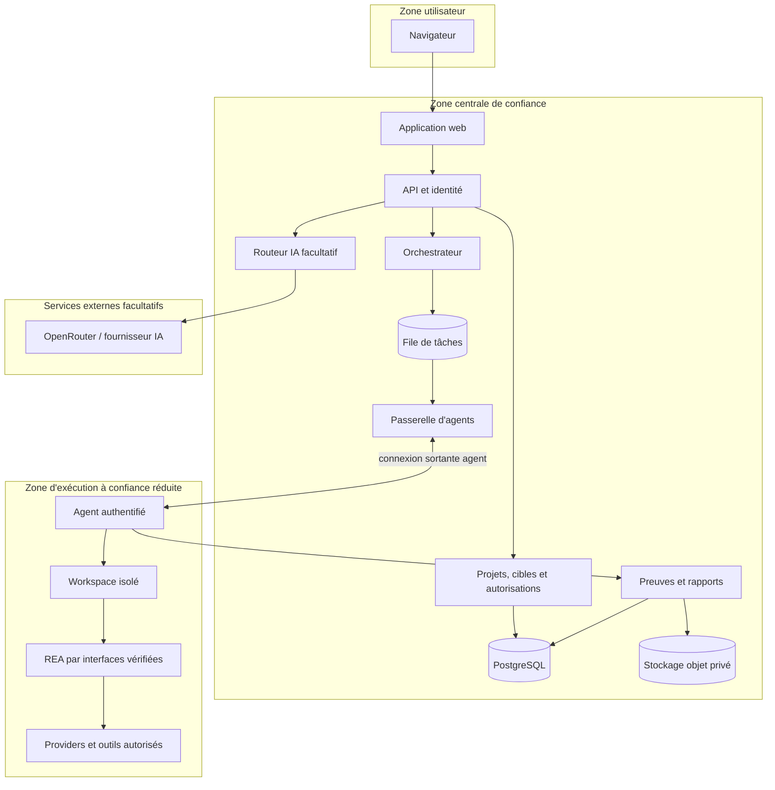

# Architecture détaillée — conception logique

**Statut :** architecture proposée. Les interfaces REA restent à confirmer par l'audit de sa révision de référence.

## 1. Principes d'architecture

- monolithe modulaire initial pour le backend ;
- agent distinct du service central ;
- séparation entre plan de contrôle (projets, accès, jobs) et plan d'exécution (agent, REA, outils) ;
- événements et résultats identifiés et corrélés ;
- toutes les interfaces externes derrière des adaptateurs versionnés ;
- pas de réseau de commande entrant vers une machine locale ;
- pas de transfert de fichier ou résultat vers un fournisseur externe sans politique explicite.

## 2. Zones et composants

## 3. Frontières de confiance

- Le navigateur n'est pas une autorité : toute permission est vérifiée côté serveur.
- Le backend est l'autorité sur identité, périmètre, approbation et attribution des jobs.
- L'agent est un exécuteur isolé à privilèges minimaux, non un serveur de commande générique.
- REA et ses outils sont des dépendances exécutées avec les permissions strictes requises.
- Les résultats d'une cible sont des données non fiables et peuvent contenir des instructions malveillantes ; elles ne doivent pas être interprétées comme des commandes système.
- Le service IA reçoit seulement un sous-ensemble explicitement autorisé et minimisé.

## 4. Modules backend

1. **Identity & Access :** identité, sessions, rôles, autorisations, révocation.
2. **Workspace/Project :** espaces, projets, membres, paramètres et journaux.
3. **Target & Authorization :** cible, empreinte/provenance, périmètre, exclusions, preuves d'autorisation et échéance.
4. **Analysis :** demande, état, configuration, événements et annulation.
5. **Orchestration :** sélection, réservation d'agent, file, idempotence et reprise.
6. **Agent Registry :** identité, heartbeat, version, santé et capacités déclarées avec source/horodatage.
7. **REA Adapter :** traduction entre les contrats de plateforme et les interfaces REA vérifiées ; conservation des réponses et erreurs sources.
8. **Evidence/Artifact :** métadonnées, intégrité, liens, accès et rétention.
9. **AI Router :** filtrage de données, sélection, budget, fallback et journal d'appel.
10. **Resource Intake :** quarantaine, inspection, décision d'approbation et retrait.
11. **Report :** documents versionnés et références probantes.
12. **Audit/Observability :** journal d'événements de sécurité et métriques sans secrets.

## 5. Flux d'attribution

1. L'API authentifie l'utilisateur et vérifie son droit sur le projet.
2. Le service d'autorisation vérifie l'échéance, le domaine/fichier, l'action demandée et les exclusions.
3. L'analyse est créée dans un état non exécutable tant que les validations ne sont pas satisfaites.
4. L'orchestrateur compare les exigences du job aux déclarations d'agents suffisamment récentes.
5. Le job est livré à un agent identifié ; l'agent vérifie à nouveau sa validité et accuse réception.
6. L'agent exécute uniquement l'opération autorisée selon l'adaptateur REA validé.
7. Les résultats et événements sont enregistrés de manière idempotente ; les erreurs et limites sont conservées.
8. L'orchestrateur clôture avec un état vérifié. Une reconnexion seule ne transforme pas un job interrompu en réussite.

## 6. Contrat conceptuel d'agent

L'agent doit accepter des tâches déclaratives à schéma fermé, jamais une commande shell arbitraire issue de l'utilisateur ou d'un modèle. Chaque opération comporte un identifiant unique, le projet/job, l'identité de cible, une liste d'actions permises, une échéance, les limites de ressources et les approbations requises. Le contrat final dépendra de l'audit REA.

## 7. Résilience

- événements dotés d'un identifiant stable et dédupliqués ;
- tentative de reprise bornée et journalisée ;
- tâche annulée distinguée d'une tâche terminée ;
- résultats partiels conservés avec statut incomplet ;
- capacité d'agent expirée invalidée ou revalidée ;
- panne fournisseur IA n'empêche pas l'archivage des résultats REA.

## 8. Choix d'infrastructure encore proposés

Next.js, Node.js/TypeScript, PostgreSQL, stockage S3/R2 et Redis/BullMQ sont des candidats de conception, non des choix d'hébergement déjà validés. La communication temps réel (WebSocket, SSE ou interrogation), le fournisseur d'identité, les sauvegardes et la résidence des données restent à décider.

## 9. Dépendance audit

Avant de figer le REA Adapter, il faut épingler une révision officielle et vérifier les commandes/outils réellement exposés, leurs schémas, transports, cycle de vie, preuves, erreurs et annulation. Aucun détail de `rea providers --json` ou `rea capabilities --json` n'est réputé confirmé ici.