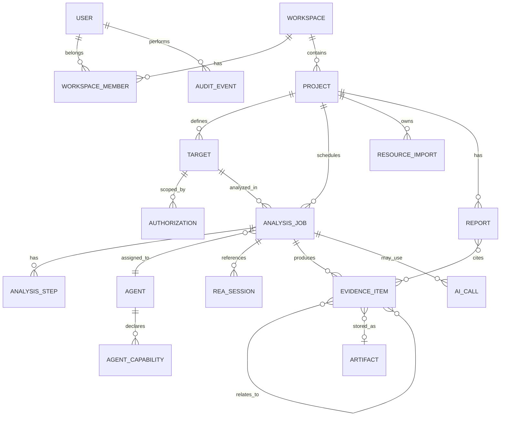

# Modèle de données — conception conceptuelle

Ce modèle décrit les concepts métier. Il ne prescrit ni DDL, ni ORM, ni migration.

## Entités et relations

## Attributs conceptuels principaux

- **Project :** identifiant, workspace, nom, objectif, classification, état, paramètres.
- **Target :** type, identifiant/source, empreinte si fichier, périmètre, provenance, sensibilité.
- **Authorization :** autorité, preuve/référence, périmètre, exclusions, catégories permises, début/expiration, statut de révocation.
- **AnalysisJob :** demandeur, cible, paramètres approuvés, état plateforme, agent, dates, version de politique et corrélation.
- **AgentCapability :** nom/identifiant provenant de la source, version REA/provider, environnement, présence/diagnostic, horodatage et fraîcheur.
- **REA Session/Invocation :** identifiants originaux si disponibles, méthode d'appel, nom d'outil/provider constaté, version, statut et références sources.
- **EvidenceItem :** identifiant interne/source, type, contenu ou artefact, provenance, temps, complétude, limites, classification et liens.
- **AI Call :** fournisseur/modèle, tâche, statut, coût/tokens quand disponibles, politique de partage, références de preuves transmises.
- **AuditEvent :** acteur, action, ressource, décision, résultat, date, corrélation et détails minimisés.

## Invariants

1. Toute preuve reliée à une analyse conserve la référence de sa source ; une synthèse n'écrase pas la sortie originale.
2. Une capacité comporte une source et un instant d'observation ; une capacité périmée ne suffit pas à attribuer un job.
3. Une conclusion publiée référence une ou plusieurs preuves ou indique explicitement qu'elle est une hypothèse.
4. Chaque artefact est associé à un propriétaire/projet, une empreinte et une politique d'accès/rétention.
5. Une autorisation peut être révoquée sans effacer l'historique d'audit.
6. L'identifiant de provider, de session ou de preuve REA est stocké comme valeur externe opaque tant que son contrat n'est pas vérifié.

## Stockage proposé

PostgreSQL pour entités et index relationnels ; stockage objet privé pour contenus volumineux. Les clés de chiffrement, régions, durées de rétention, partitionnement et stratégie de suppression sont à décider. Redis/file éventuelle ne serait pas la source de vérité des états métier.

## Classification des connaissances

`observé`, `dérivé`, `hypothèse`, `inconnu`, `validé` sont des catégories de la plateforme. Elles ne sont pas attribuées au moteur REA sans validation de son contrat.